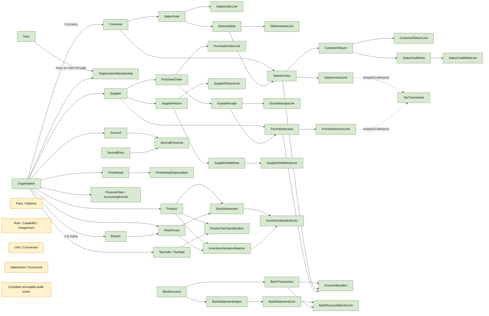

# Nexora ERP — Entity Relationship Diagram

**Current** means an entity exists in repository models. **Proposed** means a design target only. This diagram shows major Phase 1 relationships, not every field or every historical event. It is not an implemented schema.

## Cardinality and traceability notes

- Each operational document belongs to one organization; it may have a branch. The database does not consistently prove referenced rows share that organization, as discussed in `DATABASE_DESIGN.md`.
- Header-to-line is one-to-many. Current constraints differ by document; verify a specific model before relying on a uniqueness rule.
- SalesInvoice may reference a DeliveryNote one-to-one; SalesCreditNote may reference a CustomerReturn one-to-one. PurchaseInvoice lines can optionally reference receipt and order lines.
- InventoryValuationEntry has an optional one-to-one StockMovement link; opening and revaluation events need not have one. Generic source model/id is not an FK.
- InvoiceAllocation has one bank transaction and exactly one optional source invoice in current constraints. A bank transaction can have multiple allocations.
- TaxTransaction source link is drawn dotted because it is a generic string/integer pair rather than a relational FK.
- `CustomerReceipt` is an existing legacy entity outside the banking allocation path; reconcile its semantics before merging or retiring it.
- Proposed Party/Address, Role/Capability, UOM, Document and complete audit entities map to MST-01..05, IAM-02, OPS-01, AUD-01 and inventory/purchase/sales requirements. Their inclusion and scope must be approved before schema work.
- CRM, POS, manufacturing, payroll, projects, and other Phase 1 candidate features are intentionally not diagrammed as approved entities; see `PHASE_1_REPORT.md` for unresolved scope.
