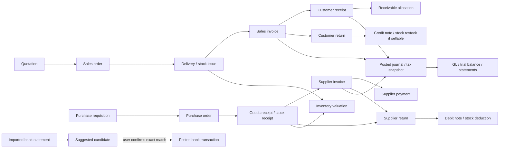

# Nexora ERP navigation map — Phase 1

## Current route and menu map

The shared navigation is in `templates/base.html`. It is rendered for every authenticated user; links are not hidden by role. A visible link does not prove that its destination grants access.

| Menu group | Current label | Current destination | Screen IDs / linked pages | Notes |
|---|---|---|---|---|
| Workspace | Dashboard | `/dashboard/` | SCR-DASH-01 | Root `/` also renders a separate minimal dashboard view from `core.HomeView`; unify later. |
| Business | Sales | `/sales/` | SCR-SAL-05-L/F/D | Invoice list, create and detail/post. |
| Business | Sales orders | `/sales/orders/` | SCR-SAL-03-L/F/D, SCR-SAL-04-F, SCR-SAL-05-FD | Detail links to deliveries and invoice flow. |
| Business | Purchases | `/purchases/` | SCR-PUR-05-L/F/D | Supplier invoice list/create/detail. |
| Business | Purchase orders | `/purchases/orders/` | SCR-PUR-03-L/F/D, SCR-PUR-04-F/E/D, SCR-PUR-05-FR | PO → receipt → supplier invoice. |
| Business | Returns | `/returns/customers/` | SCR-RET-01–06 | Customer and supplier lists share return domain; supplier-return list is reached from return pages/doc links, not directly from the base menu. |
| Business | Inventory | `/inventory/` | SCR-INV-01–03, 06–08 | Product/warehouse setup, adjustments, transfer, opening value from inventory page. |
| Business | Stock valuation | `/inventory/valuation/` | SCR-INV-05 | As-of report and CSV; opening-value action linked from inventory screen. |
| Finance | Banking | `/banking/` | SCR-BNK-01–05, 08 | Accounts, transaction, statement import and reconciliation. |
| Finance | Receivables | `/banking/receivables/` | SCR-BNK-06 | AR register and unapplied advances. |
| Finance | Payables | `/banking/payables/` | SCR-BNK-07 | AP register and unapplied advances. |
| Finance | Taxation | `/taxation/` | SCR-TAX-01–07 | Setup, sales/purchase register and internal summaries. |
| Finance | Accounting | `/accounting/reports/trial-balance/` | SCR-ACC-01–04, SCR-ACC-06–09, SCR-ACC-12 | Trial balance entry point. |
| Finance | Reports | `/accounting/reports/profit-and-loss/` | SCR-ACC-03 | Duplicate entry into accounting reporting rather than a report catalogue. |
| Finance / collapsed | Financial periods | `/accounting/periods/` | SCR-ACC-06/07 | Current `details` disclosure labelled “More finance tools”. |
| Finance / collapsed | Budgets | `/accounting/budgets/` | SCR-ACC-08 | Current route. |
| Finance / collapsed | Fixed assets | `/accounting/fixed-assets/` | SCR-ACC-09 | Current route. |
| Account | Signed-in user and log out | POST `/logout/` | SCR-AUTH-01 | No profile, active role or organization switcher. |
| Framework | Django admin | `/admin/` | No Nexora screen ID | Apps' admin registration files are placeholders. This is not a substitute for user-facing administration. |

Paths are exact current route prefixes; IDs and individual route suffixes are in `SCREEN_INVENTORY.md`.

## Proposed complete information architecture

Keep the established teal Nexora shell. Add the current organization/branch context in the header and show only navigation the signed-in user may discover. Continue to enforce permissions on every route. Put seldom-used tools under a labeled “More” group without hiding core workflow lists.

```mermaid
flowchart TD
  Home[Workspace: Dashboard]
  Admin[Administration]
  Admin --> Org[Organization and branches]
  Admin --> Users[Users and roles]
  Admin --> Audit[Audit history]
  Masters[Masters]
  Masters --> Parties[Customers and suppliers]
  Masters --> Catalog[Products, services, units]
  Masters --> Accounts[Chart of accounts]
  Sales[Sales]
  Sales --> Leads[Enquiries and quotations]
  Sales --> Orders[Orders and deliveries]
  Sales --> Invoices[Invoices and credit notes]
  Sales --> AR[Receivables]
  Purchase[Purchasing]
  Purchase --> Requisitions[Requisitions and supplier quotes]
  Purchase --> PO[Purchase orders and receipts]
  Purchase --> Bills[Supplier invoices and debit notes]
  Purchase --> AP[Payables]
  Stock[Inventory]
  Stock --> Balance[Stock ledger and reorder]
  Stock --> Value[Valuation and stock count]
  Stock --> Move[Adjustments, transfers and traceability]
  Finance[Finance]
  Finance --> Banking[Banking and reconciliation]
  Finance --> Accounting[Accounting and close]
  Finance --> GST[Tax and GST reports]
  Reports[Reports and exports]
  Extensions[Selected business extensions]
  Extensions --> POS[POS / retail]
  Extensions --> MFG[Manufacturing]
  Extensions --> HR[HR / payroll]
  Extensions --> CRM[CRM / service / projects]
```

**Nav visibility rules:** organization and user setup only to organization administrators; role-specific workspaces appear only when the capability is granted; audit is read-only; tax setup is separate from tax reports; branch-wide selectors are omitted or locked for branch-assigned users. Never rely on presentation to protect data.

## Cross-module journeys and navigation links

The current application implements only part of these paths. Current customer quote/enquiry screens, supplier requisitions/quotes, direct journal entry creation, statement filing and many master screens are absent. The real present order-to-delivery/invoice and PO-to-receipt/invoice paths are documented in the README and workflow tests. Links from a document should show its source, children, accounting journal, stock movement and tax snapshot where those records exist.

## Navigation usability and consistency findings

- Two Sales links and two Purchasing links are useful module shortcuts, but active styling marks all links in a module at once; use a single clear selected item and breadcrumbs.
- Receivables/payables and P&L appear as separate top-level items while other reports live under Accounting. A Reports catalogue should consolidate this without removing fast links.
- The base menu always shows module destinations regardless of role. Screen-level controls are more granular than navigation; review consistency after role policy approval.
- The Taxation page's registration of internal reports must not be titled or positioned as a filing action.
- Return list exposes customer list directly; provide an adjacent, explicit customer/supplier switch and source-document entry points.
- Root `/` and `/dashboard/` have different view implementations/context; root should redirect or resolve to the single scoped dashboard.
- No visible active organization/branch/year selector exists. This is material for multi-branch use and report interpretation.
- No breadcrumbs, global search, saved views or consistent per-list export controls were found. Pagination/filter retention is inconsistent.

