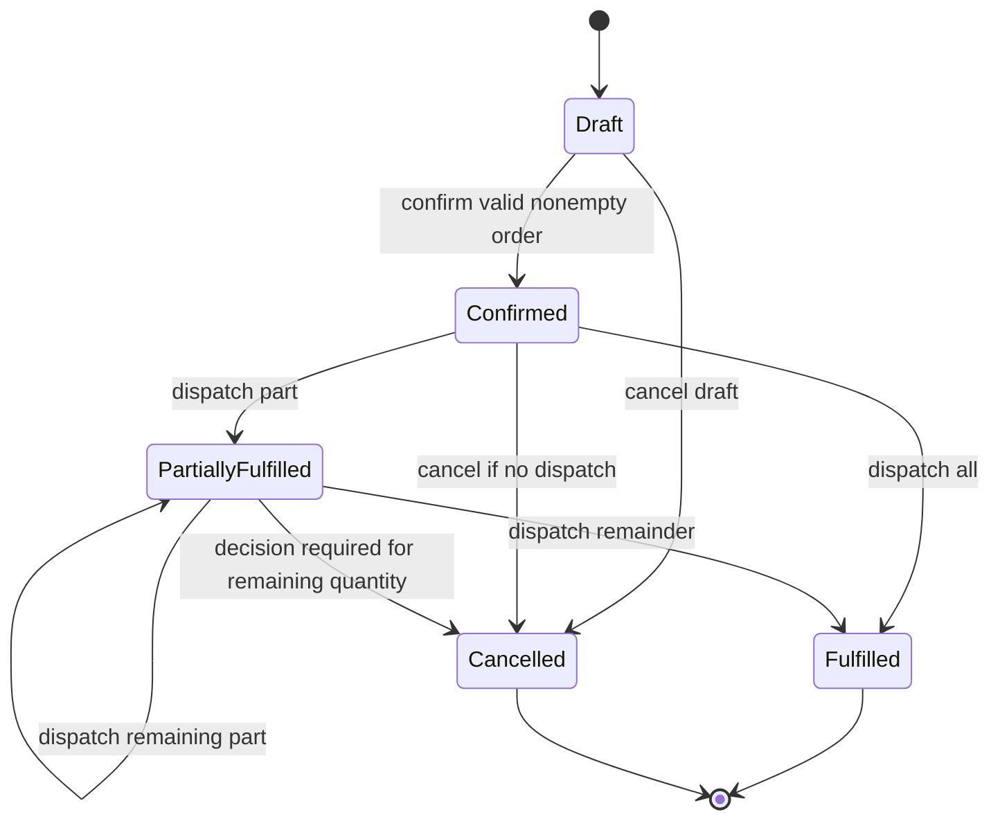
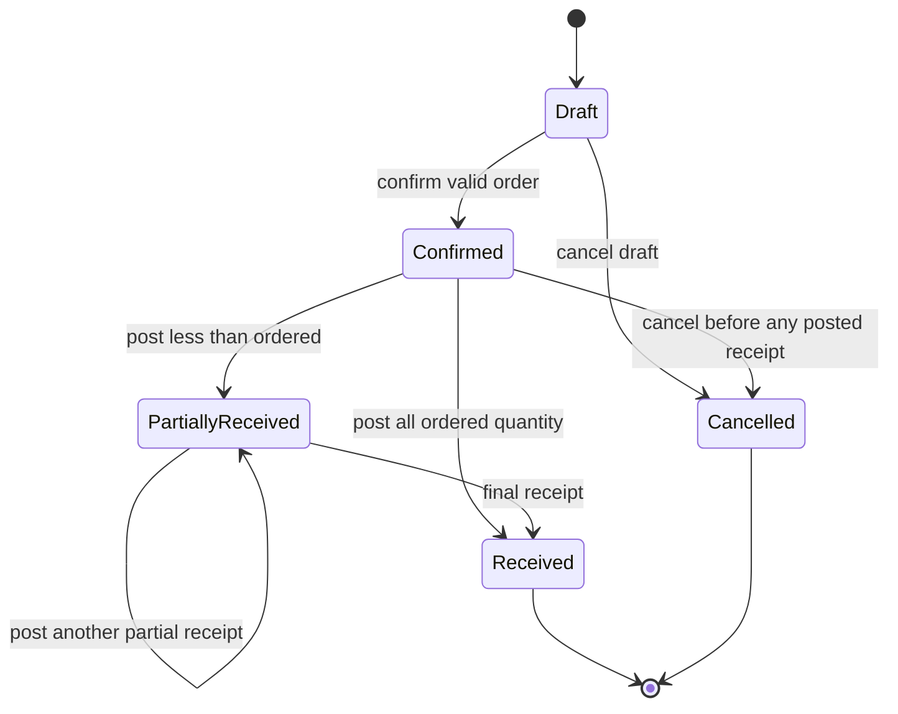
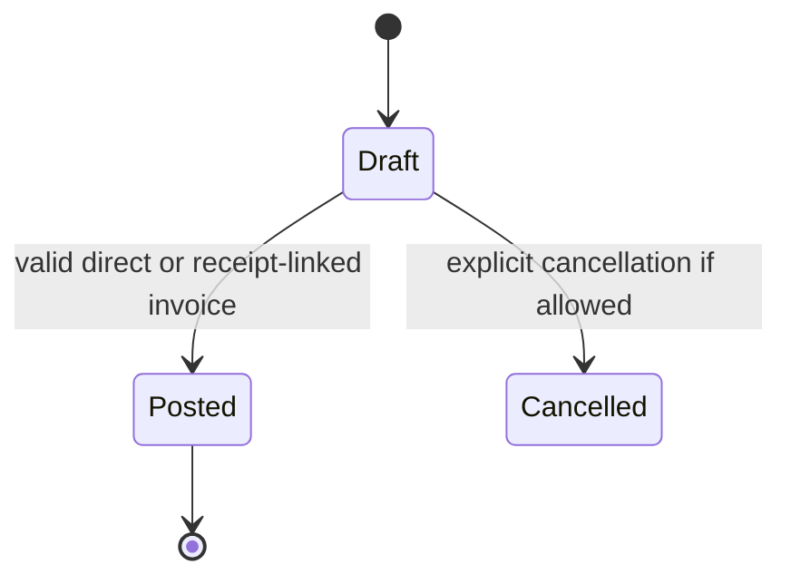
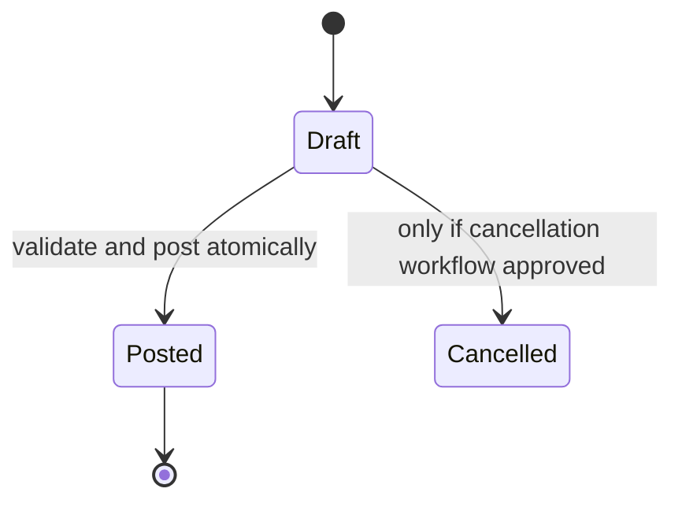
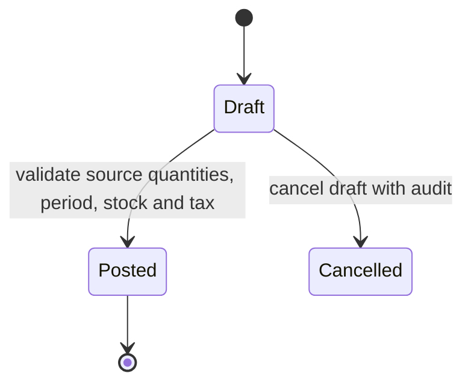
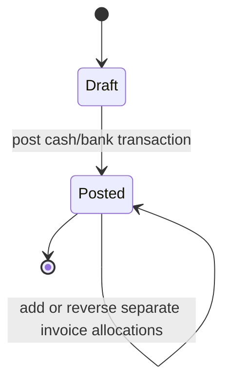
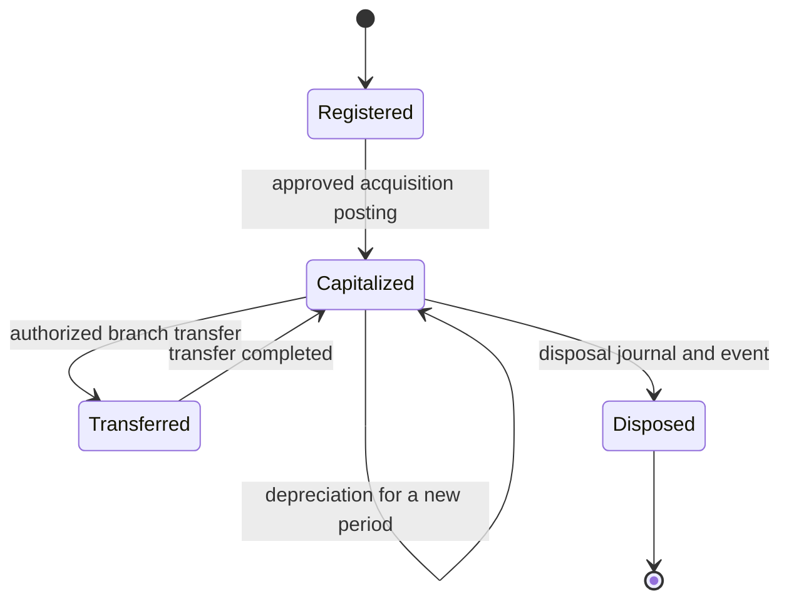

# Nexora ERP — Workflow State Machines

These diagrams specify target transitions where supported by Phase 1 and current source. They are not all identical to current model choice strings. State changes require server-side permission, tenant scope, validation and audit. A failed transition leaves current state unchanged. “Proposed” transitions need owner approval before implementation.

## Decision and status vocabulary

Current models use several distinct strings (`draft`, `posted`, `cancelled`, `confirmed`, `fulfilled`, `dispatched`, `partially_received`, `received`, `reconciled`, etc.). This document uses business labels; reconcile exact enumerations against the model before coding. Returns in particular have conflicting prose/status descriptions. No bulk status rename is specified.

## Sales order and fulfillment — SAL-03/04

Confirmation is current behavior and does not reserve stock. Delivery note has its own draft-to-dispatched transition; dispatched delivery is immutable and invoiceable. Whether a partially fulfilled order may be cancelled, and what happens to open quantity, is blocked pending Operations/Sales policy. A delivery post creates stock movement exactly once.

## Purchase order / goods receipt — PUR-03/04

Goods receipt has independent draft → posted lifecycle; repeat post is idempotent. Quality inspection/rejected quantities are not a current workflow. Whether a partially received PO can be closed/cancelled and how rejected goods affect order quantity require approval. Receipt posting currently adds stock valuation but does not post GRNI.

## Supplier invoice — PUR-05

Posted invoice is immutable; correct via supplier debit/credit workflow or approved journal correction. The exact cancelled state and cancellation rules should be confirmed against current model before exposing a new action. Receipt-linked invoice consumes no second stock quantity.

## Sales invoice — SAL-05

Current invoice choices include draft/posted/cancelled, but generic draft cancel is not a complete current UI. Posted invoices are not edited; correction is a linked credit note. Failed post remains draft. Retrying posted invoice returns existing result.

## Returns and notes — SAL-07 / PUR-07

Return status strings and note transitions must be verified and harmonized before implementation because prior prose uses different terms. Posted return is immutable, with linked credit/debit note, journal, snapshot reversal and optional stock event. Retry does not create a second note or ledger effect.

## Bank transaction, allocation and reconciliation — BNK-01/02

An allocation has its own lifecycle: active → reversed (reason and correcting journal); original allocation stays. Statement line: imported unmatched → reconciled only after explicit exact match; reconciled → unmatched only via authorized reasoned action. Suggestions are not state transitions. An unapplied payment remains an advance.

## Journal, period and year-end — ACC-01/04

```mermaid
stateDiagram-v2
  [*] --> JournalDraft
  JournalDraft --> JournalPosted: balanced and open period
  JournalDraft --> JournalCancelled: if draft cancellation allowed
  JournalPosted --> ReversedByNewJournal: new opposite journal in open period

  [*] --> PeriodOpen
  PeriodOpen --> PeriodClosed: blockers clear; authorized close
  PeriodClosed --> PeriodOpen: authorized reopen with reason

  [*] --> YearEndInProgress
  YearEndInProgress --> YearEndClosed: preview passes; journals generated
  YearEndClosed --> YearEndClosed: immutable final state
```

Year-end close has no generic reopen/reverse path. If error found, stop posting and obtain approved manual correction design; retain close and generated journals. Do not route year-end journals through a general closed-period exception.

## Fixed asset lifecycle — ACC-06

Method, schedule, transfer effectiveness and disposal conditions require approved policy. Duplicate depreciation per asset/period is rejected. Disposed assets cannot receive future depreciation; exact date cutoff and partial period treatment are blocked pending Finance approval.

## Access, audit, and state transition guard

For every transition: actor active, tenant and branch authorized, source state reread in transaction, preconditions pass, event and all ledger effects commit together, and audit captures actor/time/object/transition/reason where required. Failed validation creates no partial posted state. Current permissions vary by route; target permission mapping remains blocked until the role/capability decision is approved.
